<div align="center">

# Planetbase Trainer

**Un menu de triche intégré à [Planetbase](https://store.steampowered.com/app/403190/Planetbase/) : 48 triches à activer une par une, chacune avec son raccourci clavier modifiable.**

[](https://github.com/LASCAMPIA67/PlanetbaseTrainer/releases/latest)
[](https://github.com/LASCAMPIA67/PlanetbaseTrainer/actions/workflows/ci.yml)
[](LICENSE)
[](https://store.steampowered.com/app/403190/Planetbase/)
[](https://github.com/BepInEx/BepInEx)

[English](README.md) · **Français**

[Installation](#installation) · [Utilisation](#utilisation) · [Triches](#triches) · [Paramètres](#paramètres) · [FAQ](#faq) · [Compiler depuis les sources](#compiler-depuis-les-sources)

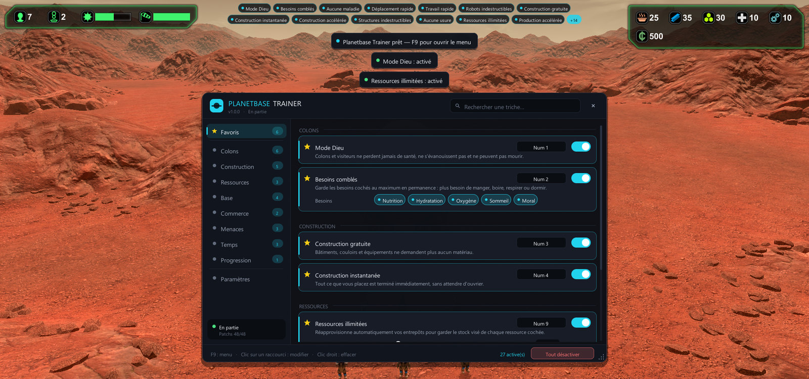

</div>

## Fonctionnalités

- **48 triches en 8 catégories** : colons, construction, ressources, réseaux de la base, commerce, menaces, temps et progression.
- **Chaque triche est indépendante** : activez-la ou désactivez-la depuis le menu, ou avec son propre raccourci sans ouvrir le menu.
- **Changez n'importe quel raccourci en un clic**, combinaisons avec <kbd>Ctrl</kbd> / <kbd>Maj</kbd> / <kbd>Alt</kbd> et boutons latéraux de la souris comprises. Les conflits sont réglés automatiquement.
- **Favoris et recherche instantanée**, pour garder vos triches préférées à portée de clic.
- **HUD des triches actives et notifications**, avec position, couleur d'accent et taille du menu au choix.
- **Français et anglais**, choisis automatiquement selon la langue de Windows.
- **Sûr par défaut** : les succès Steam sont bloqués tant que vous trichez, les actions risquées demandent confirmation et <kbd>Début</kbd> coupe tout d'un coup.
- **Vos sauvegardes restent standard** : le trainer passe uniquement par les fonctions du jeu, donc une partie sauvegardée avec lui se charge très bien sans lui.
- **Conçu pour résister aux mises à jour** : chaque patch est appliqué séparément. Si une mise à jour du jeu en casse un, seules les triches concernées sont grisées.

<table>
  <tr>
    <td>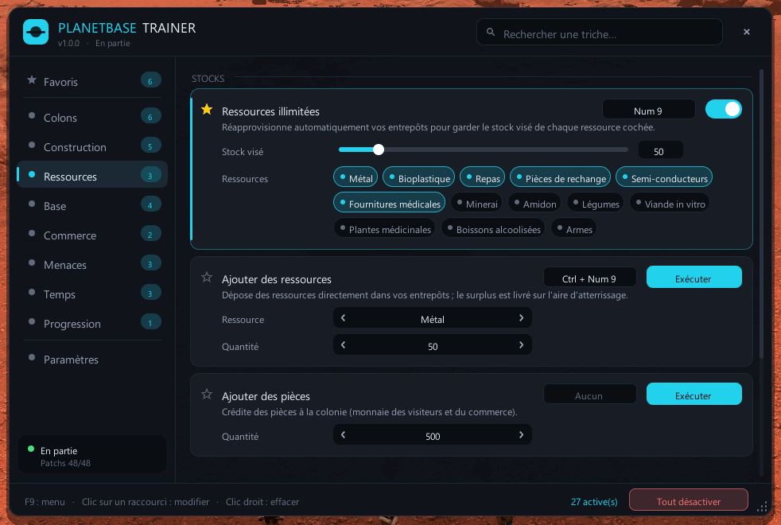</td>
    <td>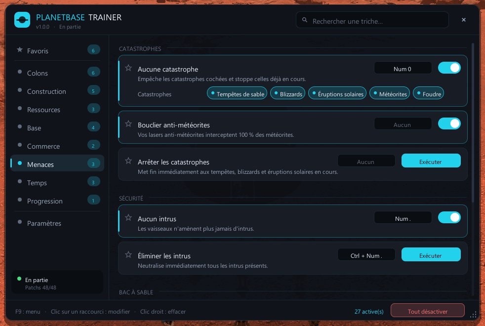</td>
  </tr>
  <tr>
    <td>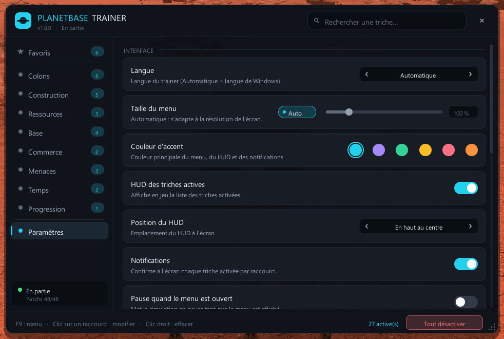</td>
    <td>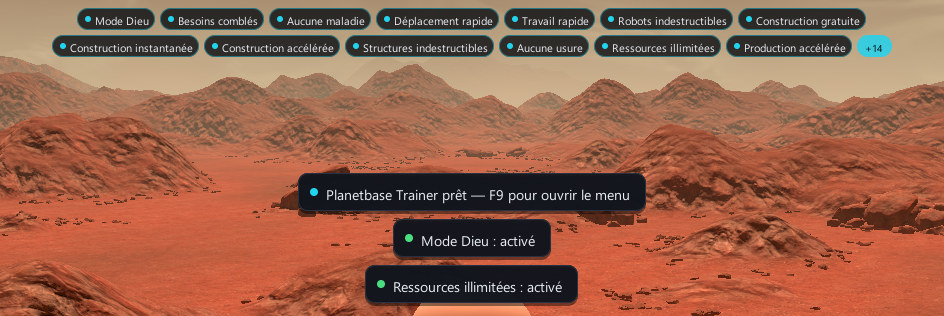</td>
  </tr>
</table>

<details>
<summary><b>Plus de captures d'écran</b></summary>

| | |
| --- | --- |
| 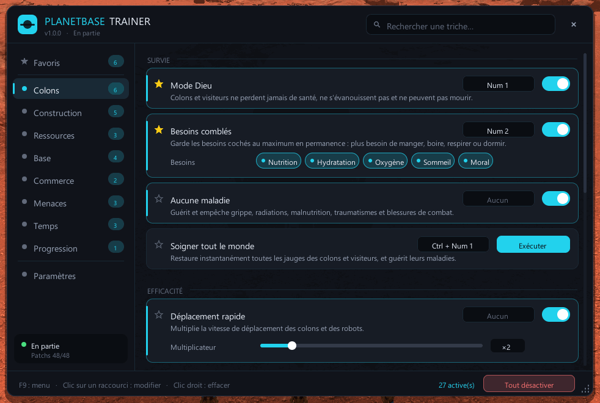 | 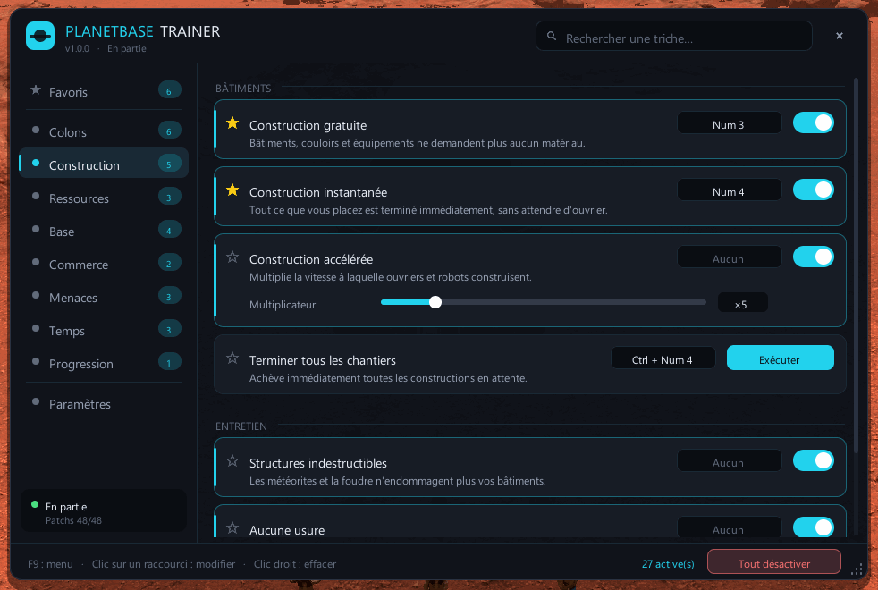 |
| 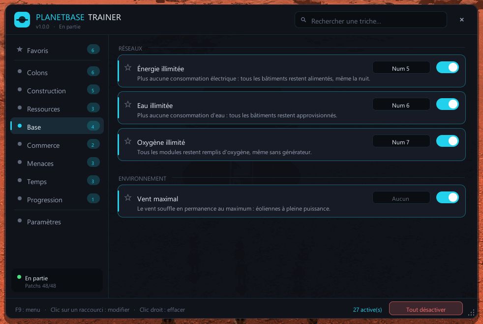 | 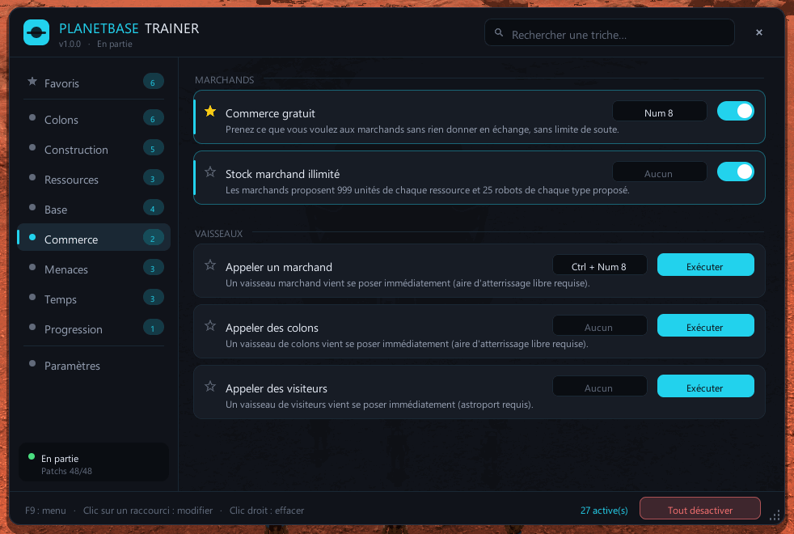 |
| 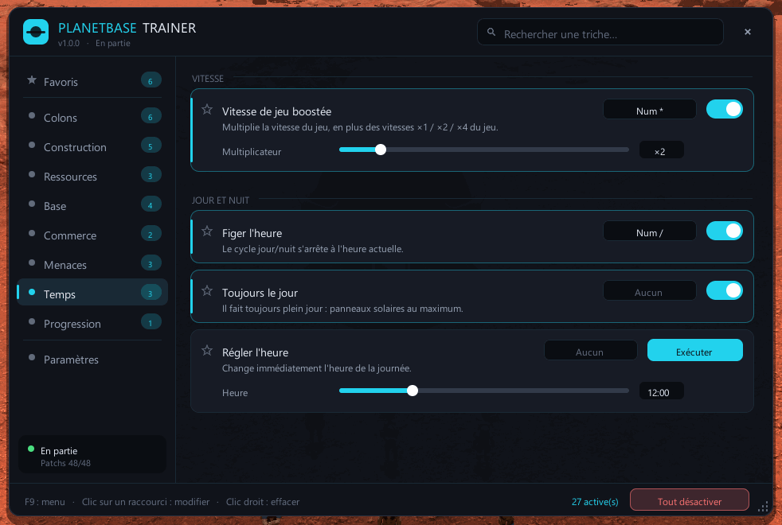 | 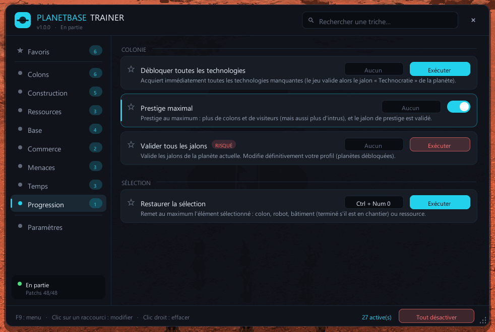 |
| 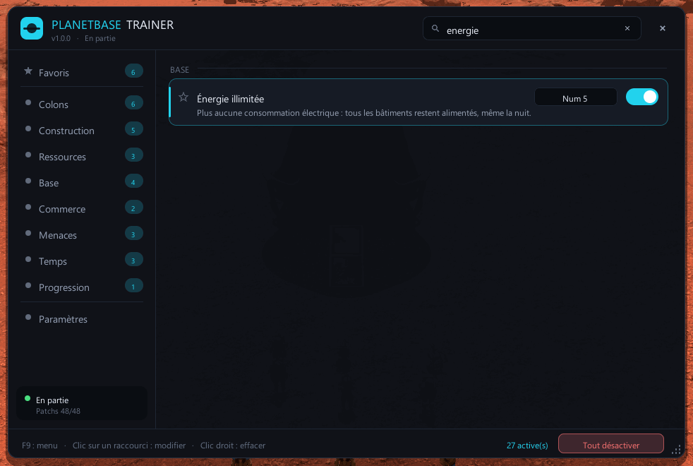 | |

</details>

## Configuration requise

- **Planetbase 1.4.x pour Windows.** Testé avec la version 1.4.2 (build Steam 20301361).
- **BepInEx 5 x86**, la version 32 bits, car Planetbase est un jeu 32 bits. Il est inclus dans le téléchargement tout-en-un.

## Installation

> [!TIP]
> Vous débutez avec les mods ? Prenez le paquet tout-en-un : il contient BepInEx et le trainer, il n'y a rien d'autre à installer.

1. Téléchargez [**PlanetbaseTrainer-with-BepInEx.zip**](https://github.com/LASCAMPIA67/PlanetbaseTrainer/releases/latest/download/PlanetbaseTrainer-with-BepInEx.zip) depuis la [dernière version](https://github.com/LASCAMPIA67/PlanetbaseTrainer/releases/latest).
2. Ouvrez le dossier du jeu : dans Steam, clic droit sur **Planetbase** › **Gérer** › **Parcourir les fichiers locaux**.
3. Extrayez le zip **dans ce dossier**, de sorte que `winhttp.dll` se retrouve à côté de `Planetbase.exe`.
4. Lancez Planetbase depuis Steam, comme d'habitude. Une notification confirme que le trainer est chargé : *Planetbase Trainer prêt — F9 pour ouvrir le menu*.

Vous utilisez déjà BepInEx 5 x86 pour d'autres mods ? Téléchargez plutôt [**PlanetbaseTrainer.zip**](https://github.com/LASCAMPIA67/PlanetbaseTrainer/releases/latest/download/PlanetbaseTrainer.zip) et extrayez-le de la même façon dans le dossier du jeu.

<details>
<summary><b>Contenu des paquets</b></summary>

```text
Planetbase/                                       (le dossier du jeu)
├── winhttp.dll, doorstop_config.ini, …           chargeur de BepInEx (paquet tout-en-un uniquement)
└── BepInEx/
    ├── core/                                     BepInEx lui-même (paquet tout-en-un uniquement)
    └── plugins/PlanetbaseTrainer/
        ├── PlanetbaseTrainer.dll                 le trainer
        └── LICENSE, README, CHANGELOG, …         documentation et licences
```

Chaque version publie aussi les empreintes SHA-256 de ses fichiers dans `SHA256SUMS.txt`.

</details>

## Utilisation

| Pour… | Faites ceci |
| --- | --- |
| Ouvrir ou fermer le menu | Appuyez sur <kbd>F9</kbd>. Ça marche partout, y compris dans le menu principal. |
| Activer ou désactiver une triche | Cliquez sur son interrupteur, ou appuyez sur son raccourci (le menu peut rester fermé). |
| Lancer une action (soigner, ajouter des ressources…) | Cliquez sur **Exécuter**, ou appuyez sur son raccourci. |
| Changer un raccourci | Cliquez sur le raccourci affiché sur la carte de la triche, puis appuyez sur la nouvelle touche ou combinaison. |
| Effacer un raccourci | Clic droit dessus, ou <kbd>Retour arrière</kbd> pendant que le trainer attend une touche. |
| Désactiver toutes les triches | Appuyez sur <kbd>Début</kbd>, ou cliquez sur **Tout désactiver**. |
| Épingler une triche dans les Favoris | Cliquez sur l'étoile à côté de son nom. |
| Trouver une triche | Tapez dans le champ de recherche. Les accents sont ignorés. |
| Déplacer ou redimensionner le menu | Faites glisser sa barre de titre ou son coin inférieur droit. Les deux sont mémorisés. |

Les clics et la molette sur le menu n'atteignent jamais le jeu, et ce que vous tapez dans la recherche ou en choisissant un raccourci ne déclenche pas les raccourcis du jeu. Impossible de placer un bâtiment ou de zoomer par erreur.

> [!NOTE]
> Les raccourcis par défaut utilisent le pavé numérique, que le jeu n'utilise pas (sauf <kbd>+</kbd> et <kbd>-</kbd> pour la vitesse du jeu). Activez **Verr. Num**. Sur un clavier sans pavé numérique, choisissez d'autres touches.

## Triches

Les **interrupteurs** restent actifs jusqu'à ce que vous les coupiez. Les **actions** s'exécutent une fois à chaque déclenchement. Les options (multiplicateurs, quantités, types) se règlent sur la carte de chaque triche. Les actions marquées **risqué** dans le menu peuvent nuire à votre colonie, et les plus radicales demandent une confirmation : cliquez ou appuyez sur leur raccourci une seconde fois.

### Colons

| Triche | Type | Raccourci par défaut | Effet |
| --- | --- | --- | --- |
| Mode Dieu | Interrupteur | <kbd>Num 1</kbd> | Colons et visiteurs ne perdent jamais de santé, ne s'évanouissent pas et ne peuvent pas mourir. |
| Besoins comblés | Interrupteur | <kbd>Num 2</kbd> | Garde en permanence au maximum les besoins cochés : nutrition, hydratation, oxygène, sommeil et moral. |
| Aucune maladie | Interrupteur | | Guérit et empêche grippe, radiations, malnutrition, traumatismes et blessures de combat. |
| Soigner tout le monde | Action | <kbd>Ctrl</kbd> + <kbd>Num 1</kbd> | Restaure instantanément toutes les jauges des colons et des visiteurs, et guérit leurs maladies. |
| Déplacement rapide | Interrupteur | | Colons et robots marchent plus vite : de ×1,5 à ×5 (×2 par défaut). |
| Travail rapide | Interrupteur | | Construction, production, réparation et minage vont plus vite : de ×1,5 à ×10 (×3 par défaut). |
| Ajouter des colons | Action | | Fait apparaître 1, 3, 5 ou 10 ouvriers, biologistes, ingénieurs, médecins ou gardes sur l'aire d'atterrissage, ou devant un sas. |
| Robots indestructibles | Interrupteur | | Les robots ne s'usent jamais et ne tombent jamais en panne. |
| Réparer tous les robots | Action | | Remet l'état et l'intégrité de tous les robots à 100 %. |
| Ajouter des robots | Action | | Fait apparaître 1, 3, 5 ou 10 robots transporteurs, constructeurs ou foreurs. |

### Construction

| Triche | Type | Raccourci par défaut | Effet |
| --- | --- | --- | --- |
| Construction gratuite | Interrupteur | <kbd>Num 3</kbd> | Bâtiments, couloirs et équipements ne demandent plus aucun matériau, y compris les chantiers déjà placés. |
| Construction instantanée | Interrupteur | <kbd>Num 4</kbd> | Tout ce que vous placez est terminé immédiatement, sans attendre d'ouvrier. |
| Construction accélérée | Interrupteur | | Ouvriers et robots construisent plus vite : de ×2 à ×20 (×5 par défaut). |
| Terminer tous les chantiers | Action | <kbd>Ctrl</kbd> + <kbd>Num 4</kbd> | Achève immédiatement toutes les constructions en attente. |
| Structures indestructibles | Interrupteur | | Les météorites et la foudre n'endommagent plus vos bâtiments. |
| Aucune usure | Interrupteur | | Bâtiments et équipements restent à 100 % : plus aucune réparation ni pièce de rechange. |
| Réparer toutes les structures | Action | | Remet tous les bâtiments et équipements en parfait état. |

### Ressources

| Triche | Type | Raccourci par défaut | Effet |
| --- | --- | --- | --- |
| Ressources illimitées | Interrupteur | <kbd>Num 9</kbd> | Réapprovisionne vos entrepôts pour garder un stock visé (de 10 à 300, 50 par défaut) de chaque ressource cochée. Métal, bioplastique, repas, pièces de rechange, semi-conducteurs et fournitures médicales sont cochés par défaut, et les 13 ressources sont disponibles. Demande de la place libre dans vos entrepôts. |
| Ajouter des ressources | Action | <kbd>Ctrl</kbd> + <kbd>Num 9</kbd> | Dépose 10, 25, 50, 100 ou 250 unités de la ressource choisie directement dans vos entrepôts. Le surplus est livré sur l'aire d'atterrissage. |
| Ajouter des pièces | Action | | Crédite 100, 500, 1 000 ou 5 000 pièces, la monnaie des visiteurs et du commerce. |
| Production accélérée | Interrupteur | | Usines, fermes, cuisines et ateliers travaillent plus vite : de ×2 à ×10 (×3 par défaut). |
| Ressources impérissables | Interrupteur | | Les ressources laissées dehors ne se dégradent plus et ne disparaissent plus. |

### Base

| Triche | Type | Raccourci par défaut | Effet |
| --- | --- | --- | --- |
| Énergie illimitée | Interrupteur | <kbd>Num 5</kbd> | Plus aucune consommation électrique : tous les bâtiments restent alimentés, même la nuit. |
| Eau illimitée | Interrupteur | <kbd>Num 6</kbd> | Plus aucune consommation d'eau : tous les bâtiments restent approvisionnés. |
| Oxygène illimité | Interrupteur | <kbd>Num 7</kbd> | Tous les modules restent remplis d'oxygène, même sans générateur d'oxygène. |
| Vent maximal | Interrupteur | | Le vent souffle en permanence au maximum : les éoliennes tournent à pleine puissance. |

### Commerce

| Triche | Type | Raccourci par défaut | Effet |
| --- | --- | --- | --- |
| Commerce gratuit | Interrupteur | <kbd>Num 8</kbd> | Prenez ce que vous voulez aux marchands sans rien donner en échange, sans limite de soute. |
| Stock marchand illimité | Interrupteur | | Les marchands proposent 999 unités de chaque ressource et 25 exemplaires de chaque robot qu'ils vendent. |
| Appeler un marchand | Action | <kbd>Ctrl</kbd> + <kbd>Num 8</kbd> | Un vaisseau marchand se pose immédiatement. Demande une aire d'atterrissage libre. |
| Appeler des colons | Action | | Un vaisseau de colons se pose immédiatement. Demande une aire d'atterrissage libre. |
| Appeler des visiteurs | Action | | Un vaisseau de visiteurs se pose immédiatement. Demande un astroport libre. |

### Menaces

| Triche | Type | Raccourci par défaut | Effet |
| --- | --- | --- | --- |
| Aucune catastrophe | Interrupteur | <kbd>Num 0</kbd> | Empêche les catastrophes cochées (tempêtes de sable, blizzards, éruptions solaires, météorites, foudre) et stoppe celles en cours. |
| Bouclier anti-météorites | Interrupteur | | Vos lasers anti-météorites interceptent 100 % des météorites. |
| Arrêter les catastrophes | Action | | Met fin immédiatement aux tempêtes de sable, blizzards et éruptions solaires en cours. |
| Aucun intrus | Interrupteur | <kbd>Num .</kbd> | Les vaisseaux n'amènent plus jamais d'intrus. |
| Éliminer les intrus | Action | <kbd>Ctrl</kbd> + <kbd>Num .</kbd> | Neutralise immédiatement tous les intrus présents. |
| Déclencher une tempête de sable, un blizzard ou une éruption solaire | Action, risquée | | Trois actions distinctes qui lancent la catastrophe tout de suite, sur les planètes qui en connaissent. Décochez-la d'abord dans *Aucune catastrophe*. |
| Faire tomber une météorite | Action, risquée | | Une météorite s'abat près de votre base. Demande confirmation. |

### Temps

| Triche | Type | Raccourci par défaut | Effet |
| --- | --- | --- | --- |
| Vitesse de jeu boostée | Interrupteur | <kbd>Num \*</kbd> | Multiplie la vitesse du jeu de ×1,5 à ×5 (×2 par défaut), en plus des vitesses ×1, ×2 et ×4 du jeu. |
| Figer l'heure | Interrupteur | <kbd>Num /</kbd> | Le cycle jour/nuit s'arrête à l'heure actuelle. |
| Toujours le jour | Interrupteur | | Il fait toujours plein jour : les panneaux solaires tournent au maximum. |
| Régler l'heure | Action | | Change immédiatement l'heure de la journée, choisie avec un curseur par pas de 15 minutes. |

### Progression

| Triche | Type | Raccourci par défaut | Effet |
| --- | --- | --- | --- |
| Débloquer toutes les technologies | Action | | Acquiert immédiatement toutes les technologies manquantes. Le jeu valide alors le jalon « Technocratie » de la planète et l'enregistre dans votre profil. |
| Prestige maximal | Interrupteur | | Prestige au maximum : plus de colons et de visiteurs, mais aussi plus d'intrus. Le jeu valide alors le jalon de prestige. |
| Valider tous les jalons | Action, risquée | | Valide les jalons de la planète actuelle. **Modifie définitivement votre profil** (planètes débloquées). Demande confirmation. |
| Restaurer la sélection | Action | <kbd>Ctrl</kbd> + <kbd>Num 0</kbd> | Remet au maximum ce que vous avez sélectionné dans le jeu : un colon, un robot, un bâtiment (terminé s'il est encore en chantier) ou une ressource. |

## Paramètres

Tout se règle dans l'onglet **Paramètres** et s'enregistre automatiquement dans `BepInEx\config\com.lascampia.planetbasetrainer.cfg`.

| Paramètre | Par défaut | Effet |
| --- | --- | --- |
| Langue | Automatique | Français ou anglais. *Automatique* suit la langue de Windows. |
| Taille du menu | Automatique | S'adapte à la résolution de l'écran, ou se règle à la main de 75 % à 200 %. |
| Couleur d'accent | Cyan | Couleur principale du menu, du HUD et des notifications, parmi 6 couleurs. |
| HUD des triches actives | Activé | Affiche la liste des triches activées pendant que vous jouez. |
| Position du HUD | En haut au centre | En haut au centre, en haut à gauche, en haut à droite, en bas à gauche ou en bas à droite. |
| Notifications | Activé | Confirme à l'écran chaque triche activée par raccourci, et le résultat de chaque action. |
| Pause quand le menu est ouvert | Désactivé | Met la simulation en pause tant que le menu est affiché. |
| Ouvrir / fermer le menu | <kbd>F9</kbd> | Le raccourci du menu. |
| Tout désactiver | <kbd>Début</kbd> | La touche panique : coupe toutes les triches d'un coup. |
| Raccourcis par défaut | | Restaure le raccourci d'origine de chaque triche. |
| Mémoriser les triches actives | Activé | Réactive vos triches au prochain lancement du jeu. |
| Protéger les succès Steam | Activé | Aucun succès ne se débloque tant qu'une triche est active, ou dès qu'une triche a servi dans la partie en cours. |
| Protéger la progression du profil | Désactivé | Les jalons atteints grâce aux triches ne sont pas enregistrés : les planètes restent verrouillées. |

## Bon à savoir

- **Les succès Steam sont protégés par défaut.** Vous ne perdez rien : le jeu vérifie les succès en continu, ils se débloqueront plus tard dans une partie jouée sans triche.
- **Certaines triches modifient votre profil.** Les jalons débloquent de nouvelles planètes, et le jeu les enregistre dans votre profil dès qu'ils sont atteints. *Prestige maximal* et *Débloquer toutes les technologies* atteignent des jalons de cette façon. Activez **Protéger la progression du profil** pour l'empêcher pendant que vous trichez. *Valider tous les jalons* fonctionne toujours, volontairement.
- **Les catastrophes ne se déclenchent que sur les planètes qui les connaissent**, sinon le jeu ne les terminerait jamais.
- **Sauvegardez vos parties avant d'expérimenter.** Elles se trouvent dans votre dossier `Documents\Planetbase`.
- **Planetbase est un jeu solo.** Le trainer ne se connecte à rien et n'affecte aucun autre joueur.

## Désinstallation

- **Le trainer seul :** supprimez le dossier `BepInEx\plugins\PlanetbaseTrainer`, ainsi que `BepInEx\config\com.lascampia.planetbasetrainer.cfg` si vous voulez aussi oublier vos réglages.
- **Tout, BepInEx compris :** supprimez aussi `winhttp.dll`, `doorstop_config.ini`, `.doorstop_version`, `changelog.txt` et le dossier `BepInEx`. Le jeu redevient exactement tel que Steam l'a installé.

Vos sauvegardes ne sont jamais touchées. À noter : « Vérifier l'intégrité des fichiers du jeu » sur Steam ne retire pas les mods, car Steam ignore les fichiers qu'il n'a pas installés.

## FAQ

<details>
<summary><b>Rien ne se passe en jeu, F9 ne fait rien</b></summary>

Vérifiez que `winhttp.dll` est bien à côté de `Planetbase.exe`, puis lancez le jeu : un fichier `BepInEx\LogOutput.log` doit apparaître. Ouvrez-le et cherchez la ligne `Planetbase Trainer 1.0.0 ready`. Si le fichier n'apparaît pas, BepInEx ne se charge pas : vérifiez que vous avez installé la version **x86** de BepInEx 5, car la version x64 ne se charge pas dans Planetbase.

</details>

<details>
<summary><b>Une triche est grisée : « Indisponible sur cette version du jeu »</b></summary>

Une mise à jour du jeu a modifié quelque chose dont la triche dépend. Les autres triches continuent de fonctionner. Merci d'[ouvrir une issue](https://github.com/LASCAMPIA67/PlanetbaseTrainer/issues/new/choose) en indiquant votre version du jeu et en joignant votre fichier `BepInEx\LogOutput.log`.

</details>

<details>
<summary><b>Les raccourcis du pavé numérique ne marchent pas</b></summary>

Activez **Verr. Num**. Si votre clavier n'a pas de pavé numérique, cliquez sur le raccourci d'une triche dans le menu et appuyez sur une autre touche ou combinaison.

</details>

<details>
<summary><b>Le jeu a planté quand je l'ai quitté</b></summary>

BepInEx 5 a un bug connu qui peut faire planter les jeux Unity 2022.3 32 bits comme Planetbase *après* leur fermeture, même sans aucun plugin ([BepInEx#398](https://github.com/BepInEx/BepInEx/issues/398), causé par [MonoMod#329](https://github.com/MonoMod/MonoMod/issues/329)). À ce moment-là, votre partie est déjà sauvegardée. Le trainer contourne le bug en réparant la valeur corrompue juste avant la fermeture du jeu, et le journal affiche alors `Mono exit crash workaround: 1 assembly(ies) repaired`.

</details>

<details>
<summary><b>Est-ce que ça marche sous Linux, macOS ou sur Steam Deck ?</b></summary>

Seule la version Windows du jeu a été testée. Lancer la version Windows via Proton avec l'option de lancement `WINEDLLOVERRIDES="winhttp=n,b" %command%`, nécessaire à BepInEx, peut fonctionner mais n'a pas été testé.

</details>

<details>
<summary><b>Mon antivirus signale winhttp.dll</b></summary>

`winhttp.dll` est le chargeur de BepInEx ([UnityDoorstop](https://github.com/NeighTools/UnityDoorstop)). Il charge du code dans le jeu, ce que certains antivirus n'apprécient pas. Le paquet tout-en-un contient le fichier non modifié de la [version officielle BepInEx 5.4.23.5](https://github.com/BepInEx/BepInEx/releases/tag/v5.4.23.5), et chaque paquet peut être vérifié avec le fichier `SHA256SUMS.txt` de la version :

```powershell
Get-FileHash .\PlanetbaseTrainer-with-BepInEx.zip -Algorithm SHA256
```

</details>

<details>
<summary><b>Puis-je l'utiliser avec d'autres mods ?</b></summary>

Oui, s'il s'agit de mods BepInEx 5 ou de mods qui ne remplacent pas les mêmes fichiers du jeu. Le trainer ne modifie aucun fichier du jeu.

</details>

## Fonctionnement

Le trainer est un plugin [BepInEx 5](https://github.com/BepInEx/BepInEx). BepInEx le charge au lancement du jeu, et le trainer modifie le comportement du jeu en mémoire grâce à des patchs [HarmonyX](https://github.com/BepInEx/HarmonyX). Aucun fichier du jeu n'est modifié. Les patchs sont regroupés par fonctionnalité et appliqués groupe par groupe : une mise à jour du jeu ne peut donc désactiver que les triches dont les patchs ne correspondent plus. Le menu est dessiné avec l'IMGUI d'Unity et lit ses réglages dans un fichier de configuration BepInEx standard.

## Compiler depuis les sources

Il vous faut Windows, le [SDK .NET](https://dotnet.microsoft.com/download) 10 ou plus récent, et Planetbase installé : le plugin se compile contre les assemblies du jeu, qui ne sont jamais redistribuées.

```powershell
git clone https://github.com/LASCAMPIA67/PlanetbaseTrainer.git
cd PlanetbaseTrainer
.\tools\Install-BepInEx.ps1    # une seule fois : installe BepInEx 5 x86 dans le jeu, après vérification de son empreinte SHA-256
dotnet build -c Release         # compile le plugin et le copie dans le dossier BepInEx\plugins du jeu
```

Le dossier du jeu est trouvé automatiquement grâce à Steam. Sinon, passez `-p:PlanetbaseDir="D:\SteamLibrary\steamapps\common\Planetbase"` ou définissez la variable d'environnement `PLANETBASE_DIR`. [CONTRIBUTING.md](CONTRIBUTING.md) (en anglais) décrit l'organisation du projet, le vérificateur de patchs, l'auto-test en jeu et la publication des versions.

## Contribuer

Rapports de bugs, idées et pull requests sont les bienvenus. Lisez d'abord [CONTRIBUTING.md](CONTRIBUTING.md), posez vos questions dans les [Discussions](https://github.com/LASCAMPIA67/PlanetbaseTrainer/discussions), et signalez les problèmes de sécurité en privé comme l'explique [SECURITY.md](.github/SECURITY.md). Chaque participant s'engage à respecter le [code de conduite](.github/CODE_OF_CONDUCT.md). Les échanges en français sont les bienvenus.

## Remerciements

- [BepInEx](https://github.com/BepInEx/BepInEx) et [HarmonyX](https://github.com/BepInEx/HarmonyX), qui rendent possible le modding des jeux Unity.
- [Planetbase-coop](https://github.com/Elwynn18/Planetbase-coop), un autre mod BepInEx pour la même version du jeu.
- Les trainers Planetbase existants et les [tables Cheat Engine](https://fearlessrevolution.com/viewtopic.php?t=28904), dont les listes de triches ont servi de point de départ.

## Licence

[MIT](LICENSE) © 2026 LASCAMPIA. Le paquet tout-en-un contient aussi BepInEx et ses dépendances, sous leurs propres licences : voir [THIRD-PARTY-NOTICES.md](THIRD-PARTY-NOTICES.md).

Ce mod est un projet de fan non officiel. Il n'est ni affilié à Madruga Works, le développeur de Planetbase, ni à Valve, ni approuvé par eux. Utilisez-le à vos risques et périls, et sauvegardez vos parties.
