<div align="center">

# Planetbase Trainer

**An in-game cheat menu for [Planetbase](https://store.steampowered.com/app/403190/Planetbase/): 49 cheats you can turn on one by one, each with its own rebindable hotkey.**

[](https://github.com/LASCAMPIA67/PlanetbaseTrainer/releases/latest)
[](https://github.com/LASCAMPIA67/PlanetbaseTrainer/actions/workflows/ci.yml)
[](LICENSE)
[](https://store.steampowered.com/app/403190/Planetbase/)
[](https://github.com/BepInEx/BepInEx)

**English** · [Français](README.fr.md)

[Installation](#installation) · [Usage](#usage) · [Cheats](#cheats) · [Settings](#settings) · [FAQ](#faq) · [Building from source](#building-from-source)

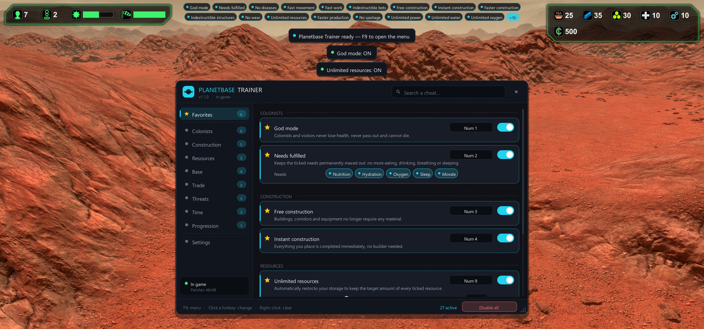

</div>

## Features

- **49 cheats in 8 categories**: colonists, construction, resources, base utilities, trade, threats, time and progression.
- **Every cheat is independent**: turn it on or off from the menu, or with its own hotkey without opening the menu.
- **Rebind any hotkey in one click**, including <kbd>Ctrl</kbd> / <kbd>Shift</kbd> / <kbd>Alt</kbd> combinations and extra mouse buttons. Conflicts are resolved for you.
- **Favorites and instant search**, so the cheats you use most are always one click away.
- **Active cheats HUD and notifications**, with a choice of position, accent color and menu size.
- **English and French**, picked automatically from your Windows language.
- **Safe by default**: Steam achievements are held back while you cheat, risky actions ask for confirmation, and <kbd>Home</kbd> turns everything off at once.
- **Your saves stay standard**: the trainer only uses the game's own functions, so a game saved with it loads fine without it.
- **Built to survive game updates**: each patch is applied on its own. If an update breaks one, only the cheats that depend on it are greyed out.

<table>
  <tr>
    <td>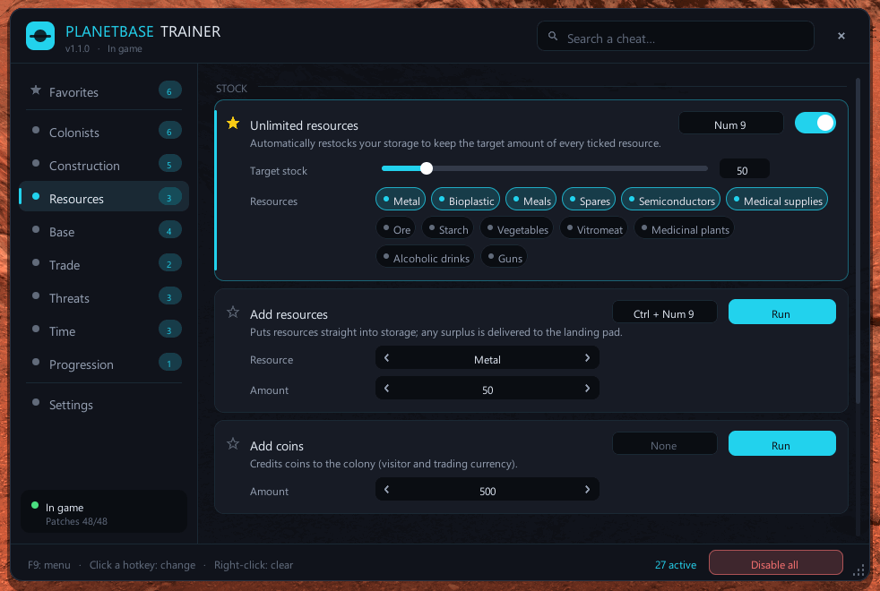</td>
    <td>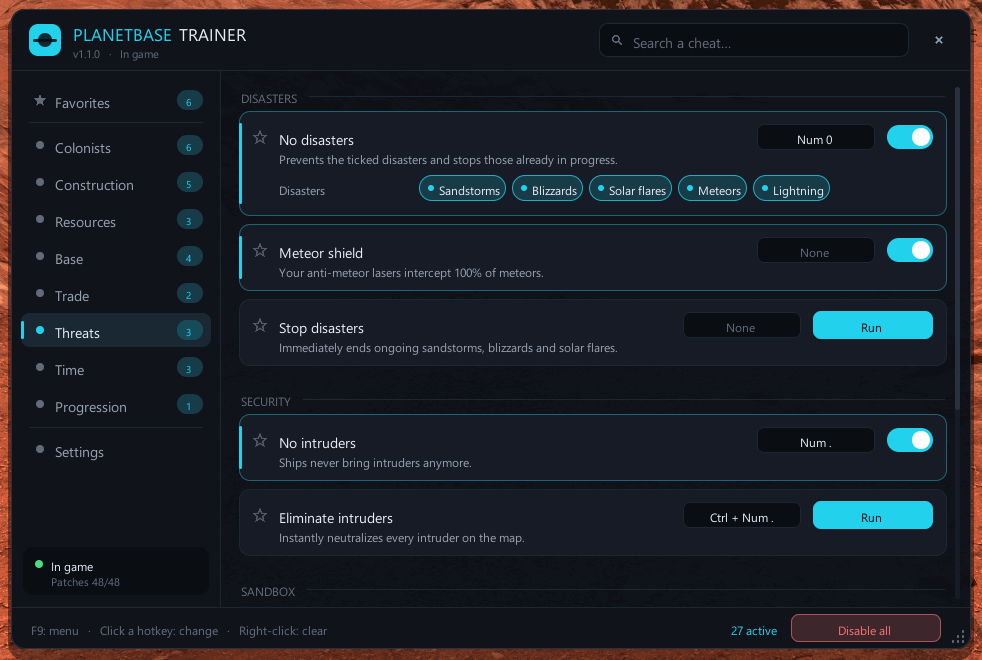</td>
  </tr>
  <tr>
    <td>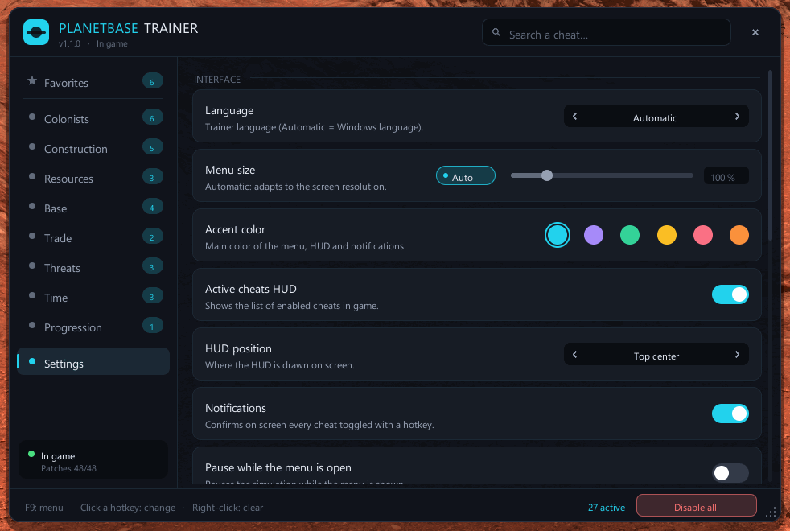</td>
    <td>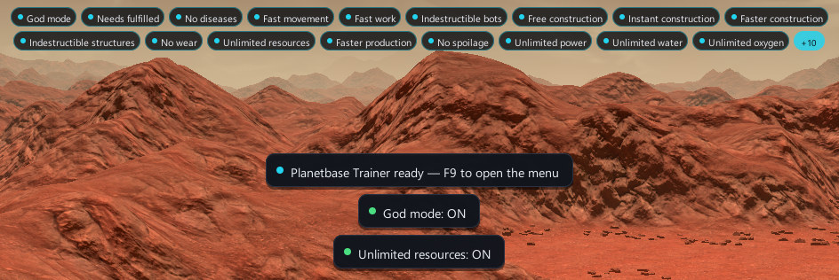</td>
  </tr>
</table>

<details>
<summary><b>More screenshots</b></summary>

| | |
| --- | --- |
| 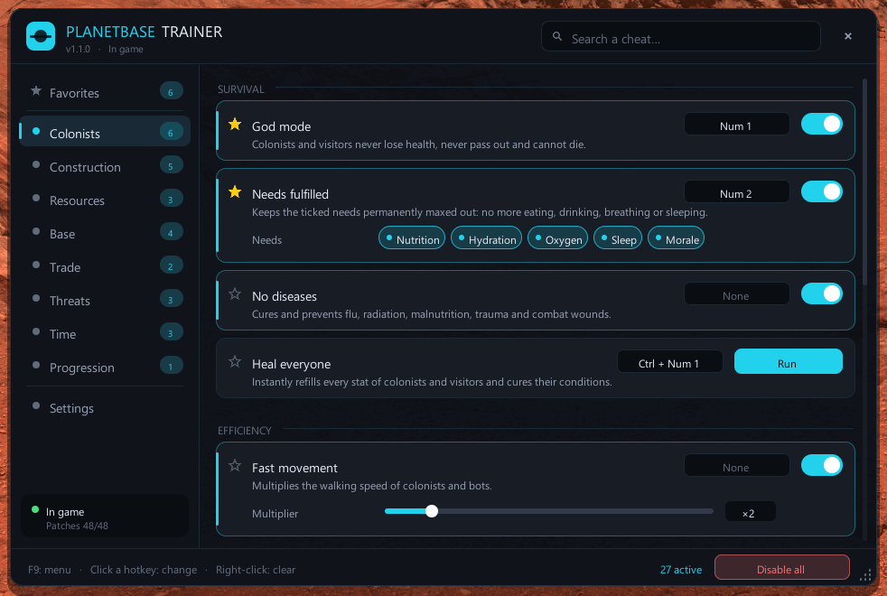 | 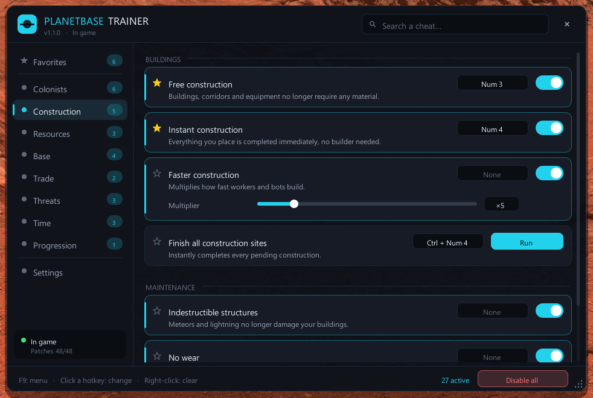 |
| 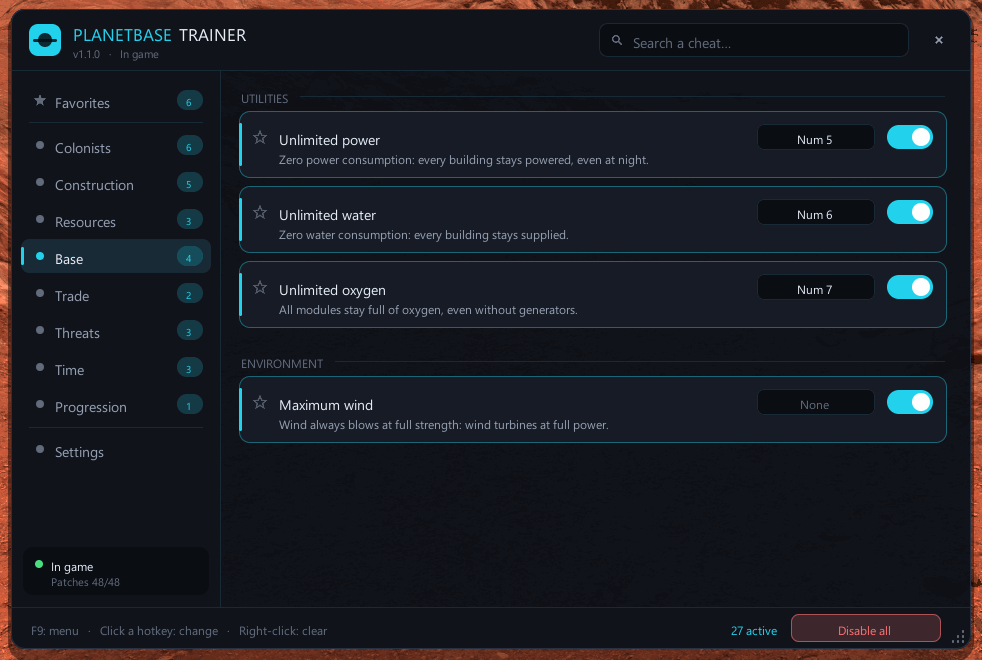 | 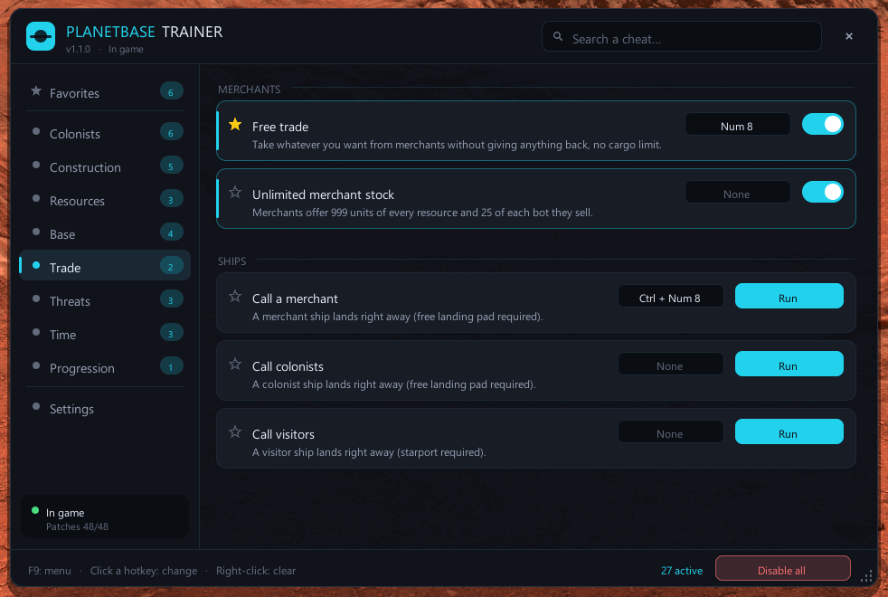 |
| 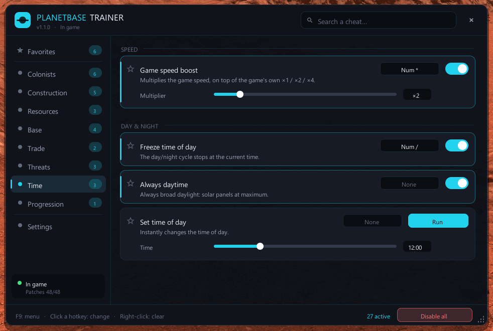 | 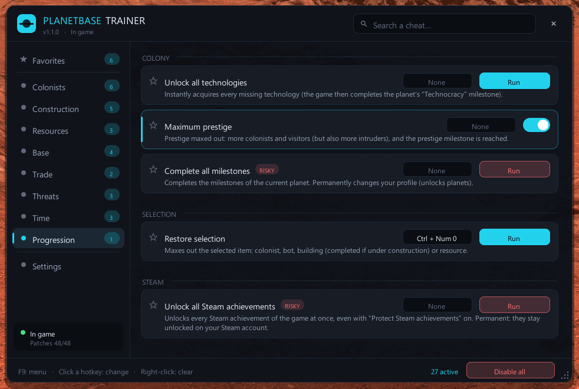 |
| 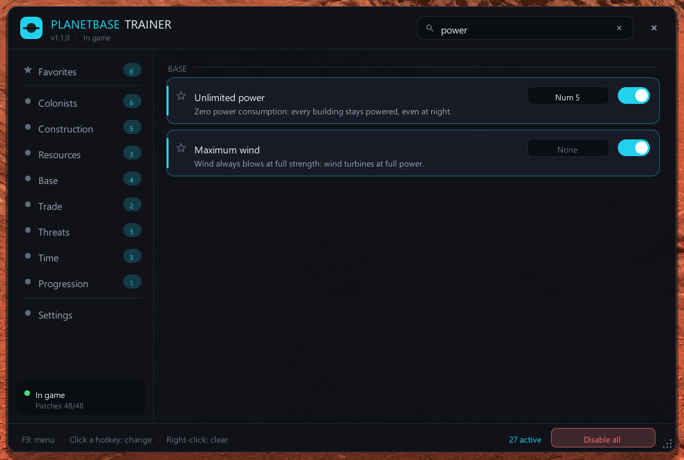 | |

</details>

## Requirements

- **Planetbase 1.4.x for Windows.** Tested with version 1.4.2 (Steam build 20301361).
- **BepInEx 5 x86**, the 32-bit build, because Planetbase is a 32-bit game. It is included in the all-in-one download.

## Installation

> [!TIP]
> New to mods? Take the all-in-one package: it contains BepInEx and the trainer, so there is nothing else to install.

1. Download [**PlanetbaseTrainer-with-BepInEx.zip**](https://github.com/LASCAMPIA67/PlanetbaseTrainer/releases/latest/download/PlanetbaseTrainer-with-BepInEx.zip) from the [latest release](https://github.com/LASCAMPIA67/PlanetbaseTrainer/releases/latest).
2. Open the game folder: in Steam, right-click **Planetbase** › **Manage** › **Browse local files**.
3. Extract the zip **into that folder**, so that `winhttp.dll` ends up next to `Planetbase.exe`.
4. Start Planetbase from Steam as usual. A notification confirms that the trainer is loaded: *Planetbase Trainer ready — F9 to open the menu*.

Already using BepInEx 5 x86 for other mods? Download [**PlanetbaseTrainer.zip**](https://github.com/LASCAMPIA67/PlanetbaseTrainer/releases/latest/download/PlanetbaseTrainer.zip) instead and extract it into the game folder the same way.

<details>
<summary><b>What the packages contain</b></summary>

```text
Planetbase/                                       (the game folder)
├── winhttp.dll, doorstop_config.ini, …           BepInEx loader (all-in-one package only)
└── BepInEx/
    ├── core/                                     BepInEx itself (all-in-one package only)
    └── plugins/PlanetbaseTrainer/
        ├── PlanetbaseTrainer.dll                 the trainer
        └── LICENSE, README, CHANGELOG, …         documentation and licenses
```

Each release also lists the SHA-256 checksums of its files in `SHA256SUMS.txt`.

</details>

## Usage

| To… | Do this |
| --- | --- |
| Open or close the menu | Press <kbd>F9</kbd>. It works everywhere, including the main menu. |
| Turn a cheat on or off | Click its switch, or press its hotkey (the menu can stay closed). |
| Run an action (heal, add resources…) | Click **Run**, or press its hotkey. |
| Change a hotkey | Click the hotkey shown on the cheat's card, then press the new key or combination. |
| Clear a hotkey | Right-click it, or press <kbd>Backspace</kbd> while the trainer waits for a key. |
| Turn every cheat off | Press <kbd>Home</kbd>, or click **Disable all**. |
| Pin a cheat to Favorites | Click the star next to its name. |
| Find a cheat | Type in the search box. Accents are ignored. |
| Move or resize the menu | Drag its title bar or its bottom-right corner. Both are remembered. |

Clicks and the mouse wheel over the menu never reach the game, and what you type in the search box or when choosing a hotkey doesn't trigger the game's shortcuts. You can't place a building or zoom the camera by accident.

> [!NOTE]
> The default hotkeys use the numeric keypad, which the game doesn't use (except <kbd>+</kbd> and <kbd>-</kbd> for the game speed). Turn **Num Lock** on. On a keyboard without a keypad, rebind them to other keys.

## Cheats

**Toggles** stay on until you turn them off. **Actions** run once each time you trigger them. Options such as multipliers, amounts or types are set on each cheat's card. Actions marked **risky** in the menu can harm your colony, and the most drastic ones ask you to confirm by clicking or pressing their hotkey a second time.

### Colonists

| Cheat | Type | Default hotkey | What it does |
| --- | --- | --- | --- |
| God mode | Toggle | <kbd>Num 1</kbd> | Colonists and visitors never lose health, never pass out and cannot die. |
| Needs fulfilled | Toggle | <kbd>Num 2</kbd> | Keeps the needs you tick permanently full: nutrition, hydration, oxygen, sleep and morale. |
| No diseases | Toggle | | Cures and prevents flu, radiation, malnutrition, trauma and combat wounds. |
| Heal everyone | Action | <kbd>Ctrl</kbd> + <kbd>Num 1</kbd> | Instantly refills every stat of your colonists and visitors and cures their conditions. |
| Fast movement | Toggle | | Colonists and bots walk faster: ×1.5 to ×5 (×2 by default). |
| Fast work | Toggle | | Building, production, repair and mining go faster: ×1.5 to ×10 (×3 by default). |
| Add colonists | Action | | Spawns 1, 3, 5 or 10 workers, biologists, engineers, medics or guards on the landing pad, or in front of an airlock. |
| Indestructible bots | Toggle | | Bots never wear out and never break down. |
| Repair all bots | Action | | Restores the condition and integrity of every bot to 100%. |
| Add bots | Action | | Spawns 1, 3, 5 or 10 carrier, constructor or driller bots. |

### Construction

| Cheat | Type | Default hotkey | What it does |
| --- | --- | --- | --- |
| Free construction | Toggle | <kbd>Num 3</kbd> | Buildings, corridors and equipment no longer require any material, including the construction sites already placed. |
| Instant construction | Toggle | <kbd>Num 4</kbd> | Everything you place is completed immediately, without waiting for a builder. |
| Faster construction | Toggle | | Workers and bots build faster: ×2 to ×20 (×5 by default). |
| Finish all construction sites | Action | <kbd>Ctrl</kbd> + <kbd>Num 4</kbd> | Instantly completes every pending construction. |
| Indestructible structures | Toggle | | Meteors and lightning no longer damage your buildings. |
| No wear | Toggle | | Buildings and equipment stay at 100%: no more repairs or spare parts. |
| Repair all structures | Action | | Restores every building and piece of equipment to perfect condition. |

### Resources

| Cheat | Type | Default hotkey | What it does |
| --- | --- | --- | --- |
| Unlimited resources | Toggle | <kbd>Num 9</kbd> | Keeps your storage stocked with a target amount (10 to 300, 50 by default) of every resource you tick. Metal, bioplastic, meals, spares, semiconductors and medical supplies are ticked by default, and all 13 resources are available. Needs free storage space. |
| Add resources | Action | <kbd>Ctrl</kbd> + <kbd>Num 9</kbd> | Puts 10, 25, 50, 100 or 250 units of the chosen resource straight into storage. Any surplus is delivered to the landing pad. |
| Add coins | Action | | Credits 100, 500, 1,000 or 5,000 coins, the currency of visitors and trade. |
| Faster production | Toggle | | Factories, farms, kitchens and workshops work faster: ×2 to ×10 (×3 by default). |
| No spoilage | Toggle | | Resources left outside no longer decay or disappear. |

### Base

| Cheat | Type | Default hotkey | What it does |
| --- | --- | --- | --- |
| Unlimited power | Toggle | <kbd>Num 5</kbd> | Zero power consumption: every building stays powered, even at night. |
| Unlimited water | Toggle | <kbd>Num 6</kbd> | Zero water consumption: every building stays supplied. |
| Unlimited oxygen | Toggle | <kbd>Num 7</kbd> | Every module stays full of oxygen, even without oxygen generators. |
| Maximum wind | Toggle | | The wind always blows at full strength, so wind turbines run at full power. |

### Trade

| Cheat | Type | Default hotkey | What it does |
| --- | --- | --- | --- |
| Free trade | Toggle | <kbd>Num 8</kbd> | Take whatever you want from merchants without giving anything in exchange, with no cargo limit. |
| Unlimited merchant stock | Toggle | | Merchants offer 999 units of every resource and 25 of each bot they sell. |
| Call a merchant | Action | <kbd>Ctrl</kbd> + <kbd>Num 8</kbd> | A merchant ship lands right away. Needs a free landing pad. |
| Call colonists | Action | | A colonist ship lands right away. Needs a free landing pad. |
| Call visitors | Action | | A visitor ship lands right away. Needs a free starport. |

### Threats

| Cheat | Type | Default hotkey | What it does |
| --- | --- | --- | --- |
| No disasters | Toggle | <kbd>Num 0</kbd> | Prevents the disasters you tick (sandstorms, blizzards, solar flares, meteors, lightning) and stops those in progress. |
| Meteor shield | Toggle | | Your anti-meteor lasers intercept 100% of meteors. |
| Stop disasters | Action | | Immediately ends ongoing sandstorms, blizzards and solar flares. |
| No intruders | Toggle | <kbd>Num .</kbd> | Ships never bring intruders. |
| Eliminate intruders | Action | <kbd>Ctrl</kbd> + <kbd>Num .</kbd> | Instantly neutralizes every intruder on the map. |
| Trigger a sandstorm, a blizzard or a solar flare | Action, risky | | Three separate actions that start the disaster right now, on planets that have it. Untick it in *No disasters* first. |
| Drop a meteor | Action, risky | | A meteor strikes near your base. Asks for confirmation. |

### Time

| Cheat | Type | Default hotkey | What it does |
| --- | --- | --- | --- |
| Game speed boost | Toggle | <kbd>Num \*</kbd> | Multiplies the game speed by ×1.5 to ×5 (×2 by default), on top of the game's own ×1, ×2 and ×4. |
| Freeze time of day | Toggle | <kbd>Num /</kbd> | The day/night cycle stops at the current time. |
| Always daytime | Toggle | | Always broad daylight, so solar panels run at full power. |
| Set time of day | Action | | Instantly sets the time of day, chosen with a slider in 15-minute steps. |

### Progression

| Cheat | Type | Default hotkey | What it does |
| --- | --- | --- | --- |
| Unlock all technologies | Action | | Instantly acquires every missing technology. The game then completes the planet's "Technocracy" milestone, which it saves to your profile. |
| Maximum prestige | Toggle | | Prestige maxed out: more colonists and visitors, but also more intruders. The game then completes the prestige milestone. |
| Complete all milestones | Action, risky | | Completes the current planet's milestones. **Permanently changes your profile** (unlocks planets). Asks for confirmation. |
| Restore selection | Action | <kbd>Ctrl</kbd> + <kbd>Num 0</kbd> | Maxes out what you have selected in the game: a colonist, a bot, a building (completed if it is still being built) or a resource. |
| Unlock all Steam achievements | Action, risky | | Unlocks every Steam achievement of the game at once, even with *Protect Steam achievements* on. **Permanent**: they stay unlocked on your Steam account. Asks for confirmation. |

## Settings

Everything is in the **Settings** tab and saved automatically to `BepInEx\config\com.lascampia.planetbasetrainer.cfg`.

| Setting | Default | What it does |
| --- | --- | --- |
| Language | Automatic | English or French. *Automatic* follows the Windows language. |
| Menu size | Automatic | Adapts to the screen resolution, or set it yourself from 75% to 200%. |
| Accent color | Cyan | Main color of the menu, HUD and notifications, among 6 colors. |
| Active cheats HUD | On | Lists the enabled cheats on screen while you play. |
| HUD position | Top center | Top center, top left, top right, bottom left or bottom right. |
| Notifications | On | Confirms on screen every cheat toggled with a hotkey, and the result of every action. |
| Pause while the menu is open | Off | Pauses the simulation while the menu is shown. |
| Open / close the menu | <kbd>F9</kbd> | The menu hotkey. |
| Disable everything | <kbd>Home</kbd> | The panic key: turns every cheat off at once. |
| Default hotkeys | | Restores the original hotkey of every cheat. |
| Remember active cheats | On | Turns your cheats back on the next time you start the game. |
| Protect Steam achievements | On | No achievement unlocks while a cheat is on, or once one has been used in the current game. |
| Protect profile progression | Off | Milestones reached thanks to cheats are not saved, so planets stay locked. |

## Good to know

- **Steam achievements are protected by default.** Nothing is lost: the game checks achievements continuously, so they unlock later in a game played without cheats. If you would rather get them at once, *Unlock all Steam achievements* unlocks every one of them, permanently.
- **Some cheats change your profile.** Milestones unlock new planets, and the game saves them to your profile as soon as they are reached. *Maximum prestige* and *Unlock all technologies* reach milestones this way. Turn on **Protect profile progression** to stop that while you cheat. *Complete all milestones* always works, on purpose.
- **Disasters can only be triggered on planets that have them**, otherwise the game would never end them.
- **Back up your saves before experimenting.** They are in your `Documents\Planetbase` folder.
- **Planetbase is single-player.** The trainer doesn't affect any other player and makes no network connection of its own: only *Unlock all Steam achievements* talks to Steam, through the game's connection.

## Uninstalling

- **Trainer only:** delete the `BepInEx\plugins\PlanetbaseTrainer` folder, and `BepInEx\config\com.lascampia.planetbasetrainer.cfg` if you also want to forget your settings.
- **Everything, including BepInEx:** also delete `winhttp.dll`, `doorstop_config.ini`, `.doorstop_version`, `changelog.txt` and the `BepInEx` folder. The game is then exactly as Steam installed it.

Your saves are never touched. Note that Steam's *Verify integrity of game files* does not remove mods, because Steam ignores the files it didn't install.

## FAQ

<details>
<summary><b>Nothing happens in game, F9 does nothing</b></summary>

Check that `winhttp.dll` is next to `Planetbase.exe`, then start the game: a `BepInEx\LogOutput.log` file should appear. Open it and look for the line `Planetbase Trainer 1.1.0 ready`, with your version number. If the file doesn't appear, BepInEx isn't loading: make sure you installed the **x86** build of BepInEx 5, since the x64 build doesn't load in Planetbase.

</details>

<details>
<summary><b>A cheat is greyed out: "Unavailable on this game version"</b></summary>

A game update changed something the cheat relies on. The other cheats keep working. Please [open an issue](https://github.com/LASCAMPIA67/PlanetbaseTrainer/issues/new/choose) with your game version and your `BepInEx\LogOutput.log` file.

</details>

<details>
<summary><b>The numeric keypad hotkeys don't work</b></summary>

Turn **Num Lock** on. If your keyboard has no numeric keypad, click a cheat's hotkey in the menu and press another key or combination.

</details>

<details>
<summary><b>The game crashed when I quit it</b></summary>

BepInEx 5 has a known bug that can crash 32-bit Unity 2022.3 games like Planetbase *after* they have quit, even without any plugin ([BepInEx#398](https://github.com/BepInEx/BepInEx/issues/398), caused by [MonoMod#329](https://github.com/MonoMod/MonoMod/issues/329)). Your game is already saved by then. The trainer works around it by repairing the corrupted value just before the game closes, and the log then shows `Mono exit crash workaround: 1 assembly(ies) repaired`.

</details>

<details>
<summary><b>Does it work on Linux, macOS or the Steam Deck?</b></summary>

Only the Windows version of the game has been tested. Running the Windows version through Proton with the launch option `WINEDLLOVERRIDES="winhttp=n,b" %command%`, which BepInEx needs, may work but is untested.

</details>

<details>
<summary><b>My antivirus flags winhttp.dll</b></summary>

`winhttp.dll` is the loader of BepInEx ([UnityDoorstop](https://github.com/NeighTools/UnityDoorstop)). It loads code into the game, which some antivirus programs dislike. The all-in-one package contains the unmodified file from the [official BepInEx 5.4.23.5 release](https://github.com/BepInEx/BepInEx/releases/tag/v5.4.23.5), and every package can be checked against the release's `SHA256SUMS.txt`:

```powershell
Get-FileHash .\PlanetbaseTrainer-with-BepInEx.zip -Algorithm SHA256
```

</details>

<details>
<summary><b>Can I use it with other mods?</b></summary>

Yes, as long as they are BepInEx 5 mods or don't replace the same game files. The trainer doesn't modify any game file.

</details>

## How it works

The trainer is a [BepInEx 5](https://github.com/BepInEx/BepInEx) plugin. BepInEx loads it when the game starts, and the trainer changes the game's behavior in memory with [HarmonyX](https://github.com/BepInEx/HarmonyX) patches. No game file is modified. Patches are grouped by feature and applied one group at a time, so a game update can only disable the cheats whose patches no longer match. The menu is drawn with Unity's IMGUI and reads its settings from a standard BepInEx configuration file.

## Building from source

You need Windows, the [.NET SDK](https://dotnet.microsoft.com/download) 10 or later, and Planetbase installed: the plugin compiles against the game's own assemblies, which are never redistributed.

```powershell
git clone https://github.com/LASCAMPIA67/PlanetbaseTrainer.git
cd PlanetbaseTrainer
.\tools\Install-BepInEx.ps1    # once: installs BepInEx 5 x86 into the game, after checking its SHA-256 hash
dotnet build -c Release         # builds the plugin and copies it into the game's BepInEx\plugins folder
```

The game folder is found automatically through Steam. If it isn't, pass `-p:PlanetbaseDir="D:\SteamLibrary\steamapps\common\Planetbase"` or set the `PLANETBASE_DIR` environment variable. [CONTRIBUTING.md](CONTRIBUTING.md) explains the project layout, the patch verifier, the in-game self-test and the release process.

## Contributing

Bug reports, ideas and pull requests are welcome. Please read [CONTRIBUTING.md](CONTRIBUTING.md) first, ask questions in [Discussions](https://github.com/LASCAMPIA67/PlanetbaseTrainer/discussions), and report security issues privately as explained in [SECURITY.md](.github/SECURITY.md). Everyone taking part is expected to follow the [code of conduct](.github/CODE_OF_CONDUCT.md).

## Acknowledgments

- [BepInEx](https://github.com/BepInEx/BepInEx) and [HarmonyX](https://github.com/BepInEx/HarmonyX), which make Unity game modding possible.
- [Planetbase-coop](https://github.com/Elwynn18/Planetbase-coop), another BepInEx mod for the same version of the game.
- The existing Planetbase trainers and [Cheat Engine tables](https://fearlessrevolution.com/viewtopic.php?t=28904), whose cheat lists served as a starting point.

## License

[MIT](LICENSE) © 2026 LASCAMPIA. The all-in-one package also contains BepInEx and its dependencies, under their own licenses: see [THIRD-PARTY-NOTICES.md](THIRD-PARTY-NOTICES.md).

This is an unofficial, fan-made mod. It is not affiliated with or endorsed by Madruga Works, the developer of Planetbase, or by Valve. Use it at your own risk and back up your saves.
